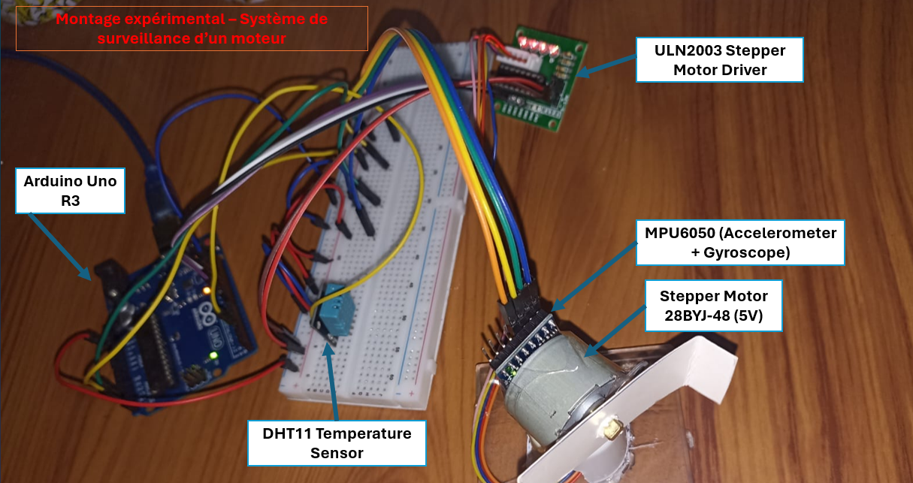
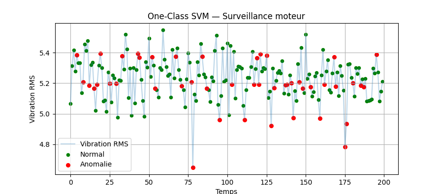

# Real-Time Motor Anomaly Detection using One-Class SVM

A motor-condition monitoring prototype that combines **Arduino sensor acquisition** and **Python machine learning** to identify abnormal motor vibration in real time.



## Overview

An Arduino collects measurements from an **MPU6050 accelerometer/gyroscope** and a **DHT11 temperature sensor** and streams sensor values over serial. The Python acquisition script computes RMS features and saves normal-condition measurements. A **One-Class SVM** is trained on normal motor data and classifies incoming vibration measurements, displaying a live chart and issuing an alert when the anomaly percentage exceeds a threshold.

**Current model scope:** The training dataset includes `vibration_rms`, `rotation_rms`, and `temperature`, but the current classifier uses **`vibration_rms` only**. Rotation and temperature are collected but not used as model inputs. The Arduino sketches also include a stepper-motor / ULN2003 setup and test modes for anomalous operation.

## Results



## Hardware

- Arduino Uno / compatible AVR development board
- MPU6050 inertial sensor
- DHT11 temperature sensor
- Stepper motor and ULN2003 driver (as implemented in the sketches)
- USB serial connection to a computer

Wiring reference: [Circuit schematic (PDF)](docs/circuit_schematic.pdf).

## Software

- Arduino IDE with libraries `Wire`, `DHT sensor library`, `Adafruit Unified Sensor`, and `Adafruit MPU6050`
- Python 3 with dependencies in [`requirements.txt`](requirements.txt)

## Getting started

1. Install Python dependencies:
   ```bash
   python -m pip install -r requirements.txt
   ```
2. Open `arduino/lecture_capteurs/lecture_capteurs.ino` in Arduino IDE; install the Arduino libraries above and upload it to your board.
3. In `python/acquisition_donnees.py` and `python/detection_anomalies.py`, set `PORT` to your Arduino serial port (currently `COM5`) and check the configured baud rate (`9600`). Close Arduino Serial Monitor before running Python.
4. With the motor operating normally, collect training data:
   ```bash
   python python/acquisition_donnees.py
   ```
   **Warning:** This overwrites `data/dataset_normal.csv`; back up the included sample dataset first if you wish to keep it.
5. Monitor incoming measurements using the trained One-Class SVM:
   ```bash
   python python/detection_anomalies.py
   ```
6. For the separate Arduino test configuration, see `arduino/anomalie_moteur_test/anomalie/anomalie.ino` (do not upload both sketches simultaneously).

## How detection works

1. Parse acceleration, angular velocity, and temperature from seven comma-separated serial values.
2. Compute vibration RMS as `sqrt((ax² + ay² + az²) / 3)`.
3. Fit a `StandardScaler` and `OneClassSVM(kernel="rbf", nu=0.1, gamma="scale")` on normal vibration RMS measurements.
4. Evaluate a sliding window of vibration measurements. Current configuration uses a 10-sample scoring window and an anomaly-rate alert threshold of 40%.
5. Display live normal/anomalous measurements. On Windows, an alert may trigger a beep.

## Project structure

```text
arduino/           Arduino sensor reading and anomaly test sketches
python/            Serial data acquisition and anomaly detection
data/             Normal-condition training sample
images/            Physical prototype and result plot
docs/              Circuit schematic
README.md          Project documentation
requirements.txt   Python dependencies
.gitignore         Local and generated files to exclude
```

## Notes

This is a prototype for experimental monitoring, not a certified industrial safety or fault-diagnosis system. Performance depends on the sensor placement, training conditions, motor speed, and calibration. No independent accuracy, precision, or recall metrics are asserted here.
